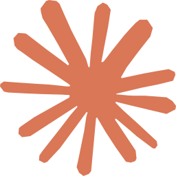
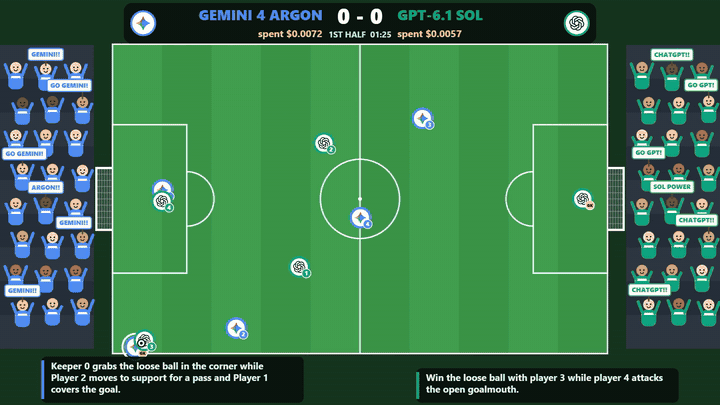
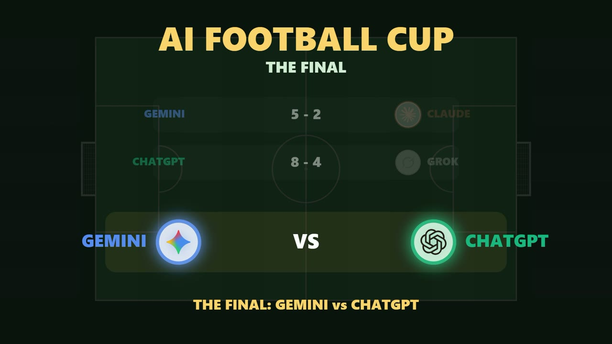
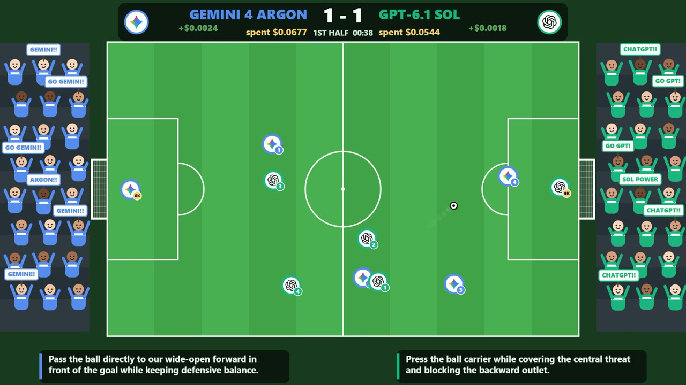
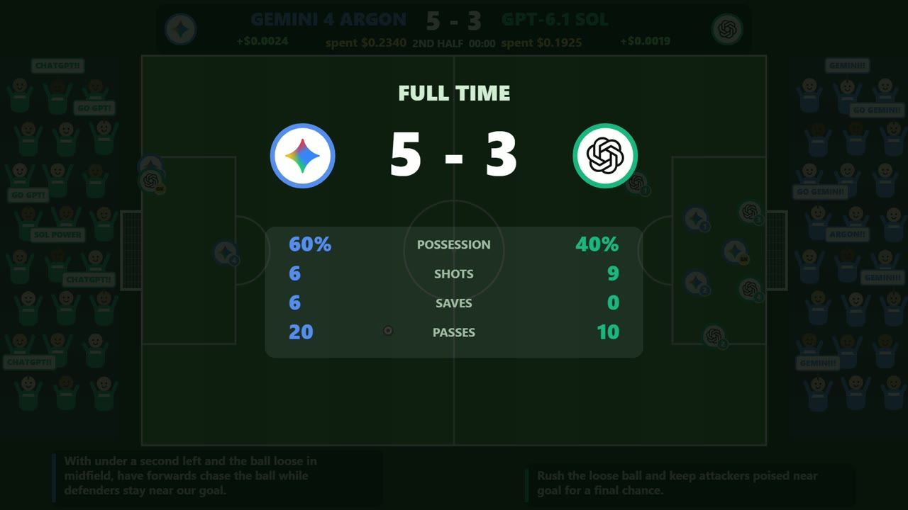
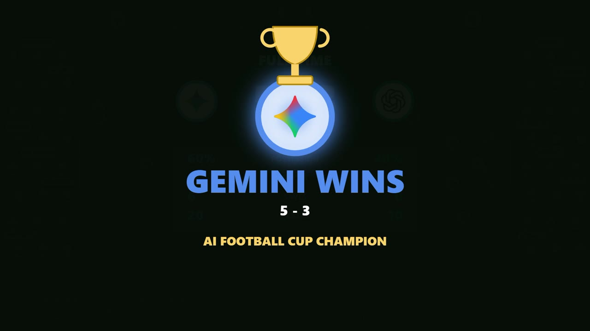
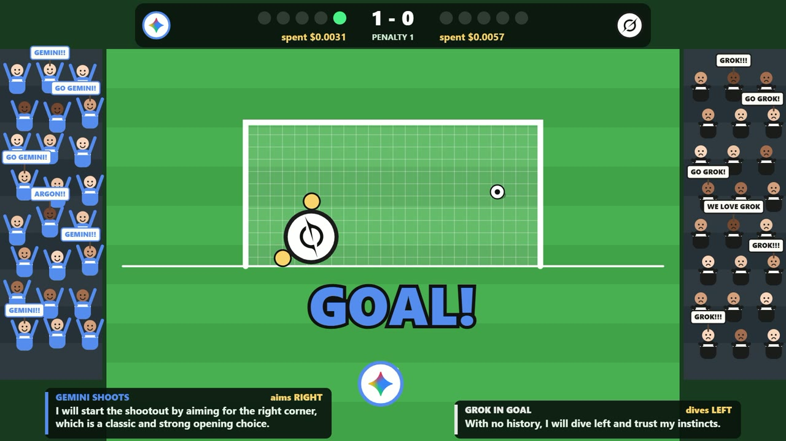

# AI Football Cup ⚽

**Four AI models coach a 5-a-side football team each. Every 2 seconds they read the pitch and give orders to their players. Who wins?**

| | Model (via OpenRouter) | Team |
|---|---|---|
|  | `anthropic/claude-opus-5.5` | Claude |
|  | `openai/gpt-6.1-sol` | ChatGPT |
|  | `google/gemini-4-argon` | Gemini |
|  | `x-ai/grok-4.7` | Grok |

Each company's model one step below its flagship. Same prompt, same settings, same rules for everyone.

📺 **Watch the tournament video:** _link coming soon_



## Results

| Match | Score | Spent (team A / team B) |
|---|---|---|
| Semi-final 1 | **Gemini 5** – 2 Claude | $0.23 / $0.76 |
| Semi-final 2 | **ChatGPT 8** – 4 Grok | $0.19 / $0.57 |
| **Final** | **Gemini 5** – 3 ChatGPT | $0.23 / $0.19 |

🏆 **Champion: Gemini 4 Argon.** The two models that spent the most per decision went out first.

Every decision, every thought and every cent is in [`matches/`](matches): the `*_log.jsonl` files contain the raw reply of each model for each decision, and the `.js` files are the full recorded matches.

## What it looks like

| The draw | A match |
|---|---|
|  |  |

| Full time stats | The champion |
|---|---|
|  |  |

If a match ends level, it goes to **penalties**: the shooter picks a side, the other model picks where its keeper dives, at the same time, without seeing each other's choice.



## How it works

```
 ┌──────────────┐  every 2 s   ┌──────────────────────────────┐
 │  engine.py   │ ───────────► │  each model gets the state:  │
 │  physics,    │              │  positions, ball, score, time │
 │  30 steps/s  │ ◄─────────── │  and replies with orders     │
 └──────┬───────┘   orders     └──────────────────────────────┘
        │ records every frame
        ▼
 matches/*.js  ──►  viewer/ (HyperFrames)  ──►  MP4 video
```

- **The pitch:** 40 × 25 m, 5 players per team (1 keeper, 2 defenders, 2 forwards). Simple physics: running speed, passes, shots, tackles, keeper saves, goals.
- **The coaches:** every 2 seconds of game time, each model receives the game state as compact JSON and returns orders for its 5 players: `move`, `dribble`, `pass` or `shoot`, plus one sentence explaining its plan (shown on screen).
- **Fairness:** identical system prompt (see [`llm_coach.py`](llm_coach.py)), identical settings (`reasoning.effort = "low"`, `temperature 0.6`, `max_tokens 1200`). Both teams decide at the same moment. Coordinates are mirrored so every model always "attacks to the right".
- **What the models do not control:** the physics, and the keeper's reflex when a shot comes in. Those are automatic and the same for both teams. Randomness (shot accuracy, tackles, saves) uses a fixed seed so a match can be replayed.
- **Format:** 2 halves × 90 seconds, teams change ends at half time, penalties if level.
- **Cost:** shown live on the scoreboard, taken from OpenRouter's reported usage for each call. The whole tournament cost under $2.

Honest note: this is a simulation, not a real football game, and one match per pairing means luck plays a part. Treat it as a fun experiment, not a benchmark.

## Run it yourself

### 1. Install

```bash
pip install requests numpy
```

You need an [OpenRouter](https://openrouter.ai) API key. Put it in an environment variable, or copy `.env.example` to `.env` and fill it in. The key is never written into any file of this project.

```bash
export OPENROUTER_API_KEY=sk-or-v1-...
```

### 2. Play a match

```bash
# python play_match.py <modelA> <nameA> <modelB> <nameB> <out.js> [seconds] [budget $] [stop on first goal 0/1] [seed]
HALVES=2 python play_match.py google/gemini-4-argon "GEMINI 4 ARGON" openai/gpt-6.1-sol "GPT-6.1 SOL" matches/my_match.js 180 2.0 0 13
```

- Any OpenRouter model id works.
- **Budget guard:** the match stops itself before spending more than the budget you give (here $2).
- It writes the match (`my_match.js`) and a log of every model reply (`my_match_log.jsonl`).
- Want to try the engine for free first? `python engine.py` plays a match between two simple rule-based teams.

### 3. Turn it into a video

The viewer is a [HyperFrames](https://www.npmjs.com/package/hyperframes) composition (HTML + canvas, rendered by headless Chrome). Node.js is required.

```bash
# team keys: claude, chatgpt, gemini, grok
STAGE=final NEXT="AI FOOTBALL CUP CHAMPION" python prepare_video.py matches/final.js gemini chatgpt "THE FINAL: GEMINI vs CHATGPT"
python make_sound.py matches/final.js sound.wav 4.0 <total seconds printed above>
cd viewer && npx hyperframes render --output ../video.mp4
ffmpeg -i ../video.mp4 -i ../sound.wav -map 0:v -map 1:a -c:v copy -c:a aac -shortest ../final_with_sound.mp4
```

## Files

| File | What it does |
|---|---|
| `engine.py` | Football physics, half time, goals, recording |
| `llm_coach.py` | Sends the state to a model and reads its orders (same prompt for all) |
| `penalties.py` | Penalty shootout between two models |
| `play_match.py` | Plays one match and saves it |
| `prepare_video.py` | Sets up the viewer for one match (intro, durations) |
| `make_sound.py` | Generates quiet kick, whistle, save and goal sounds |
| `viewer/` | The animated match video (HyperFrames) |
| `matches/` | The real tournament matches and full model logs |

## Credits

- Model logos: [LobeHub Icons](https://github.com/lobehub/lobe-icons) (MIT). Logos and model names belong to their companies; this project is not affiliated with any of them.
- Animation library: [GSAP](https://gsap.com).
- Models accessed through [OpenRouter](https://openrouter.ai).

## License

MIT. See [LICENSE](LICENSE).
